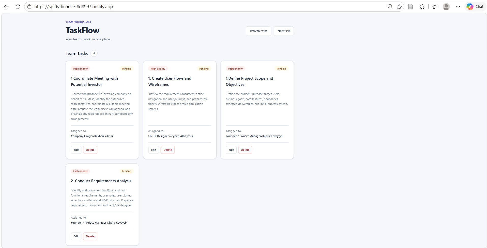

# TaskFlow Web

A task management frontend built with Angular, TypeScript, and Tailwind CSS. It connects to the [TaskFlow API](https://github.com/kkovaycin/taskflow-api) to create, display, update, and delete tasks.

## Features

- Task cards showing the title, description, assignee, status, and priority.
- A shared reactive form for creating and editing tasks.
- Required title and assignee validation, including whitespace-only input checks.
- Deletion confirmation with a cancel option.
- Loading, empty-list, and request-error states.
- Disabled actions while a request is in progress.
- Responsive layouts, shared color variables, and a custom favicon.
- Prettier formatting scripts.


## Application Screenshot

The TaskFlow dashboard provides a centralized interface for managing project tasks, assigning responsibilities, setting priorities, and tracking progress.


  

## Technologies

- Angular standalone components and signals
- TypeScript
- Angular Reactive Forms and HttpClient
- RxJS
- Tailwind CSS 4 and PostCSS
- Prettier

## Requirements

- Node.js 24.x and npm 11.x
- Git
- The TaskFlow backend running on port `3000`

The project was developed using Node.js `24.14.1` and npm `11.11.0`. The commands below use Windows PowerShell; on other platforms, use `npm` in place of `npm.cmd`.

## Run locally

Clone both repositories into the same parent directory:

```powershell
git clone https://github.com/kkovaycin/taskflow-api.git
git clone https://github.com/kkovaycin/taskflow-web.git
```

Open two terminals in that parent directory. Keep both servers running while using the application.

### Terminal 1: backend

```powershell
Set-Location .\taskflow-api
npm.cmd ci
npm.cmd run dev
```

The API runs at `http://localhost:3000`. Its health endpoint is `http://localhost:3000/health`.

### Terminal 2: frontend

```powershell
Set-Location .\taskflow-web
npm.cmd ci
npm.cmd start
```

Open `http://localhost:4200`. If Angular offers another port because `4200` is occupied, open the `Local` URL printed in the terminal.

Stopping the backend while leaving the frontend running causes task requests to fail. Start the backend again and select **Refresh tasks** to retry.

## API configuration

The frontend reads the relative API base URL from `src/environments/environment.ts`:

```typescript
export const environment = {
  apiUrl: "/api",
};
```

The `start` script loads `proxy.conf.json`. During local development, the proxy forwards `/api/**` requests to `http://localhost:3000` and removes the `/api` prefix.

| Frontend request        | Backend endpoint    | Purpose       |
| ----------------------- | ------------------- | ------------- |
| `GET /api/tasks`        | `GET /tasks`        | List tasks    |
| `POST /api/tasks`       | `POST /tasks`       | Create a task |
| `PATCH /api/tasks/:id`  | `PATCH /tasks/:id`  | Update a task |
| `DELETE /api/tasks/:id` | `DELETE /tasks/:id` | Delete a task |

The backend stores tasks in its own `data/tasks.json` file. Saving a task uses the ID and timestamps returned by the API.

## Project structure

| Path                                   | Responsibility                                  |
| -------------------------------------- | ----------------------------------------------- |
| `src/app/pages/dashboard/`             | Task loading, page state, and CRUD coordination |
| `src/app/components/task-card/`        | Task display and edit/delete events             |
| `src/app/components/task-form/`        | Task creation/editing form and validation       |
| `src/app/interfaces/task.interface.ts` | Task types and request models                   |
| `src/app/services/task.service.ts`     | HTTP requests to the API                        |
| `src/environments/environment.ts`      | API base URL                                    |
| `src/styles.css`                       | Tailwind imports and shared design tokens       |
| `proxy.conf.json`                      | Local development proxy                         |
| `public/`                              | Static assets, including the favicon            |

## Development commands

| Command                    | Purpose                                            |
| -------------------------- | -------------------------------------------------- |
| `npm.cmd start`            | Start the development server with the API proxy    |
| `npm.cmd run build`        | Create the production build in `dist/taskflow-web` |
| `npm.cmd run format`       | Format source files                                |
| `npm.cmd run format:check` | Check source formatting                            |

## Manual verification

With both servers running:

1. Select **New task**, enter a title and assignee, and create a task.
2. Check that its details appear on a card.
3. Select **Edit**, change the title or status, and select **Save changes**.
4. Reload the page and confirm that the saved changes persist.
5. Select **Delete**, then **Cancel**, and confirm that the task remains.
6. Select **Delete**, then **Yes, delete**, and confirm that the task stays deleted after a reload.
7. Submit a form with a blank title or assignee and check that validation messages appear.

The backend source is maintained in the [TaskFlow API repository](https://github.com/kkovaycin/taskflow-api).
